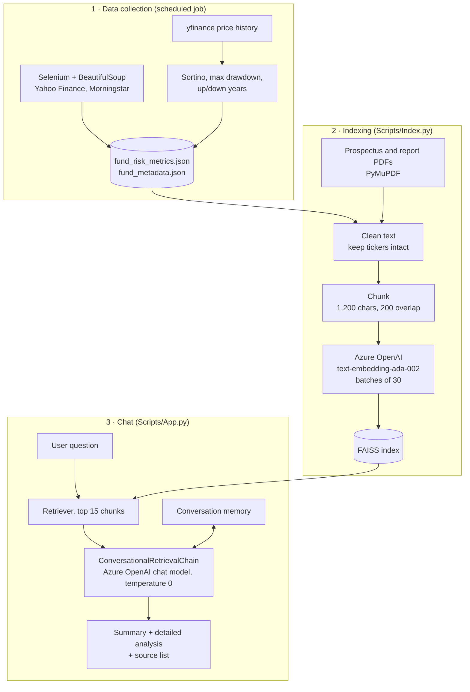

# ORION: GenAI Mutual Fund Advisor

**Optimal Risk-Investment Outreach Navigator.** A retrieval-augmented chat assistant that answers questions about mutual funds from their prospectuses, investment reports and risk metrics, and shows which documents each answer came from.

*Built during my Summer 2025 software engineering internship at Infosys.*


> [!NOTE]
> This is an internship learning project, not a product and not investment advice. The fund data is a snapshot from mid-2025. The Azure deployment used during the internship ([link](https://fundsummary-b7bub6eacvc7e7bs.eastus2-01.azurewebsites.net/)) may no longer be running.

## The problem

A financial advisor comparing funds for a client has to read long prospectuses and pull risk numbers from several sites. ORION puts that material behind one chat box. Ask "Compare VFIAX and VWELX risk metrics" and it retrieves the relevant passages and numbers, answers in a short paragraph, then gives a longer breakdown with source files listed.

## What it does

| Feature | Where it lives |
|---|---|
| Chat over 16 funds (VFIAX, VWELX, VBTLX, FMTIX, AGG, BOND and others) with conversation memory | `Scripts/App.py` |
| Two-part answers: a 3 to 4 sentence summary, then rankings, risk assessment and implications | prompt in `get_custom_prompt()` |
| Source file names appended to each analysis section | `add_citations_to_analysis()` |
| Ingestion of JSON metrics and PDF reports with ticker-aware cleaning and chunking | `Scripts/Index.py` |
| File-hash cache so unchanged documents are not re-processed | `EnhancedDocumentProcessor` |
| Batched embedding with rate-limit handling | `EnhancedFAISSIndexer` |
| Risk metric collection: alpha, Sharpe, Treynor, standard deviation scraped; Sortino and max drawdown computed from price history | `Scripts/WebScarper.py`, `Sortino.py`, `MaxDrawdown.py`, `Up.py` |
| Thumbs up/down feedback and a per-session analytics page | `handle_feedback()`, `render_analytics_page()` |
| Experimental weighted fund scoring (Sharpe, return, Sortino, Treynor, up/down ratio, drawdown penalty) | `Scripts/fund_scoring_test.py` |

## Architecture



### Retrieval pipeline in detail

1. **Load.** Three JSON files (risk metrics, fund metadata, term definitions) and the fund PDFs are read. PDF text comes from PyMuPDF.
2. **Clean.** Ticker symbols are extracted first, then text is normalized so cleaning does not mangle tickers or numeric tables.
3. **Chunk.** Up to 1,200 characters per chunk with 200 characters of overlap.
4. **Embed and store.** Chunks are embedded in batches of 30 through Azure OpenAI and written to a local FAISS index (`faiss_index_fund_data/`).
5. **Retrieve.** Each question pulls the 15 nearest chunks.
6. **Generate.** A LangChain `ConversationalRetrievalChain` sends the chunks, chat history and a structured prompt to the chat model at temperature 0, with up to 2,500 output tokens.
7. **Cite.** The app collects the source file of every retrieved chunk and lists them under the analysis.

### Example questions

```
Compare VFIAX and VWELX risk metrics
What is FMTIX alpha and how does it perform against benchmarks?
Show me VBTLX expense ratio and investment strategy
Which funds have the lowest volatility in the large-cap category?
```

## Tech stack

| Layer | Tools |
|---|---|
| UI | Streamlit with custom CSS |
| Orchestration | LangChain (`ConversationalRetrievalChain`, `ConversationBufferMemory`) |
| Models | Azure OpenAI chat deployment, `text-embedding-ada-002` embeddings |
| Vector store | FAISS (CPU) |
| Document processing | PyMuPDF, NLTK |
| Data collection | Selenium, undetected-chromedriver, BeautifulSoup, yfinance, pandas, NumPy |
| Deployment | Azure App Service via GitHub Actions; Dockerfile for the scraper job |

## Project layout

```
Scripts/
  App.py                 Streamlit app: chat, analytics and settings pages
  Index.py               Builds the FAISS index from Data/
  WebScarper.py          Scrapes risk metrics, computes Sortino
  Sortino.py             Sortino ratio from price history
  MaxDrawdown.py         Maximum drawdown
  Up.py                  Up and down years per fund
  Pdf.py                 PDF text extraction helper
  fund_scoring_test.py   Experimental weighted fund scoring
  UiApp.py, AppUITest.py Earlier UI iterations, kept for reference
Data/                    Fund metadata, risk metrics and definitions (JSON)
faiss_index_fund_data/   Prebuilt index used by the app
App_Data/jobs/           Azure WebJob that refreshes metrics on a schedule
.github/workflows/       Build and deploy to Azure App Service
Dockerfile               Container for the scraper (Chrome + Python)
```

## Setup

You need Python 3.11 or newer and an Azure OpenAI resource with one chat deployment and one `text-embedding-ada-002` deployment.

```bash
git clone https://github.com/krocks9903/-GenAi-fund-advisor-Summer-Internship-2025.git orion
cd orion
python -m venv .venv && source .venv/bin/activate   # Windows: .venv\Scripts\activate
pip install -r requirements.txt
cp .env.example .env                                 # then fill in your Azure values
```

Run the app from the repository root, because the index path is relative:

```bash
streamlit run Scripts/App.py
```

The app loads the prebuilt index in `faiss_index_fund_data/`, so you can chat without re-indexing. Questions are embedded with your deployment at query time, so it must be the same embedding model the index was built with.

### Rebuilding the index

```bash
python Scripts/Index.py
```

This needs the source PDFs in `Data/`. They are not in the repository (`*.pdf` is git-ignored), so a rebuild from a fresh clone will only cover the JSON files unless you add the PDFs listed at the top of `Index.py`.

## Limitations and status

- **Status:** internship project, last updated July 2025. Not maintained as a service.
- **No automated tests.** `fund_scoring_test.py` and `AppUITest.py` are exploratory scripts, not a test suite.
- **No evaluation set.** Answer quality was checked by hand during the internship. There are no retrieval or groundedness metrics.
- **Citations are file-level.** The app lists which files were retrieved. It does not link a sentence to a page.
- **Static data.** Metrics and documents are a 2025 snapshot covering 16 funds.
- **Analytics are per session.** Conversation and feedback counts live in Streamlit session state and reset on reload.
- **Index loading uses pickle.** `FAISS.load_local(..., allow_dangerous_deserialization=True)` is fine for the bundled index. Do not load an index from a source you do not trust.
- **Scrapers are brittle.** They depend on the page layout of third-party sites and may need fixes.
- **Pushing to `main` triggers a deploy** to the Azure app through `.github/workflows/main_fundsummary.yml`.

## What I would do next

- A small question set with expected sources, to measure retrieval hit rate
- Page-level citations
- Hybrid keyword plus vector retrieval for ticker lookups
- Move the scraper targets to a data API
- Unit tests for the metric calculations

## Acknowledgments

Built during the Infosys Summer 2025 internship program, with mentorship from the Infosys technical team and access to their Azure development environment. Thanks to my fellow interns for the collaboration.
